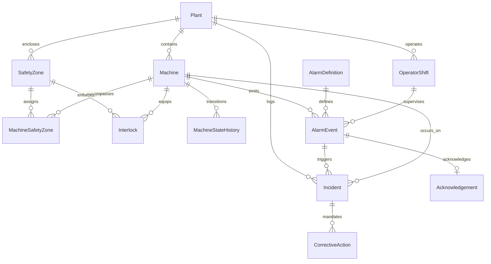

# Industrial Safety & Machine Intelligence Platform

> **An end-to-end industrial intelligence platform to analyze safety events, machine states, acknowledgements, and corrective actions to uncover repeated unsafe conditions, ensure ISA-18.2 compliance, and maintain complete audit traceability.**

---

## 1. Executive Summary & Business Context

In complex manufacturing and automation environments (automotive, precision robotics, stamping, CNC machining), safety failures frequently recur when superficial fixes or unverified corrective actions are closed without mitigating physical sensor drift or root equipment wear. Furthermore, alarm desensitization—fueled by alarm floods and chronic nuisance alarms (chattering and fleeting)—slows operator reaction times during critical perimeter intrusions.

This platform provides a complete, mathematically coherent, and auditable solution to:
1. **Model and simulate industrial safety topologies:** Plants, Machines, Safety Zones, Machine Safety Zone bridges, Interlocks, Alarm Definitions, Operator Shifts, Machine State Ledgers, Alarm Events, Acknowledgements, Incidents, and Corrective Actions.
2. **Detect Repeated Unsafe Conditions:** Identify recurrent safety incidents occurring after corrective actions were closed, detect chronic interlock sensor trips across rolling windows, and map hazardous plant zones.
3. **Enforce ANSI/ISA-18.2 & ISO 13849 Standards:** Detect alarm floods (>10 alarms / 10 min), isolate chattering tags (≥3 transitions / 60s), identify fleeting spikes (<5s), and measure operator acknowledgement latencies against strict severity-tiered SLAs.
4. **Audit Data Integrity & Edge Cases:** Detect 5 injected edge cases against separate ground truth with **100% precision, recall, and F1 score**.
5. **Ensure 100% Deterministic Reproducibility:** Fixed-seed (`20261022`) generation producing byte-for-byte identical datasets across independent runs.

---

## 2. Primary Actors & Systems

| Actor / System | Core Responsibilities & Platform Interactions |
| :--- | :--- |
| **Plant Operator** | Monitors live SCADA/HMI console telemetry, acknowledges active alarms, reviews shift turnover briefings, and responds to critical safety zone trips within SLA windows. |
| **Maintenance / Quality Engineer** | Investigates incident root causes, executes corrective action engineering (hardware replacement, interlock recalibration), audits unverified closures, and resolves recurrent failure modes. |
| **Production Planner** | Analyzes safety-induced machine downtime, correlates cell trips with line scheduling, and tracks safety zone capacity loss to prevent unplanned line shutdowns. |
| **OT/IT Administrator** | Oversees telemetry pipeline integrity, monitors clock synchronization across plant nodes, filters replay attacks, audits machine state transitions, and validates data compliance. |

---

## 3. Architecture & Domain Entity Model



### Core Entities & Cardinality
1. **Plant** (`1:N` to Machine, SafetyZone, OperatorShift, Incident)
2. **Machine** (`M:N` to SafetyZone via `MachineSafetyZone` bridge)
3. **SafetyZone** (`1:N` to Interlock; defines hazard class and SIL requirement)
4. **MachineSafetyZone** (Bridge table with `effective_from`, `effective_to`, `primary_containment`)
5. **Interlock** (`1:N` from Machine and Zone; hardware/optical safety interlocks)
6. **AlarmDefinition** (`1:N` to AlarmEvent; ISA-18.2 catalog and SLA thresholds)
7. **OperatorShift** (`1:N` to AlarmEvent, MachineStateHistory, Acknowledgement)
8. **MachineStateHistory** (`1:N` from Machine; immutable ledger of `RUNNING` ↔ `TRIPPED` transitions)
9. **AlarmEvent** (`1:1` to Acknowledgement, `1:0..1` to Incident)
10. **Acknowledgement** (`N:1` to OperatorShift, `1:1` to AlarmEvent)
11. **Incident** (`1:N` to CorrectiveAction; records OSHA reporting, lost hours, machine state)
12. **CorrectiveAction** (`N:1` to Incident; tracks engineering actions, status, QA verification)

---

## 4. ID & Nomenclature Conventions

Deterministic, zero-padded identifiers with strict regex validation:
- **Safety Zones:** `SAFE-<plant-id>-001` (e.g., `SAFE-PLT01-001`)
- **Alarm Events:** `ALM-<machine-id>-000001` (e.g., `ALM-MCH001-000001`)
- **Incidents:** `INC-2026-000001` (e.g., `INC-2026-000001`)
- **Acknowledgements:** `ACK-<alarm-id>-01` (e.g., `ACK-ALM-MCH001-000001-01`)
- **Corrective Actions:** `ACT-<incident-id>-01` (e.g., `ACT-INC-2026-000001-01`)
- **Interlocks:** `ITL-<machine-id>-01` (e.g., `ITL-MCH001-01`)
- **Alarm Definitions:** `DEF-001` to `DEF-200`
- **Operator Shifts:** `SHF-<plant-id>-YYYYMMDD-01` (e.g., `SHF-PLT01-20261001-01`)

---

## 5. Granular Requirements Verification (Steps 1–10)

| Step | Requirement | Implementation & Proof Artifacts |
| :--- | :--- | :--- |
| **Step 1** | Data Dictionary | [`docs/DATA_DICTIONARY.md`](file:///docs/DATA_DICTIONARY.md) defining types, nullability, allowed values, units, uniqueness, and validation rules for all 12 tables. |
| **Step 2** | Generation Order & Domain Logic | Master tables synthesized first (`Plant` → `Machine` → `Zone` → `Interlock` → `AlarmDef`), followed by chronological dependent event tables. |
| **Step 3** | Deterministic IDs & Reference Integrity | Canonical zero-padded IDs formatted consistently across CSV, JSON, and SQLite seeds. |
| **Step 4** | Baseline Volume & Scaling | **Full:** 4 Plants, 60 Machines, 200 Definitions, **50,250 Alarm Events** over 30 days.<br>**Starter:** 4 Plants, 12 Machines, 40 Definitions, **2,050 Alarm Events** over 7 days. |
| **Step 5** | 5 Labeled Edge Cases Injected | Injected into telemetry with discrete ground truth labels. |
| **Step 6** | Derived Values Calculated from Source | Durations, latencies, SLA breaches, and ISA-18.2 flood/chattering flags are computed mathematically from timestamps. |
| **Step 7** | Separate Ground Truth Files | Ground truth exported to dedicated `ground_truth/ground_truth_anomalies.*` and `ground_truth_recurrent.*` without target leakage. |
| **Step 8** | Complete Validation Suite | Primary key uniqueness, foreign key validity, enum constraints, and timeline ordering verified via `DatasetValidator`. |
| **Step 9** | Multi-Format Export & Manifest | Exported to CSV, JSON, SQL DDL schema, and SQLite DB with SHA-256 manifest. |
| **Step 10**| Fixed-Seed Reproducibility | Two independent executions using seed `20261022` yield identical row counts and **byte-identical SHA-256 hashes**. See [`docs/REPRODUCIBILITY.md`](file:///docs/REPRODUCIBILITY.md). |

---

## 6. The 5 Negative Scenarios / Edge Cases

| Edge Case | Operational Scenario | Detection Rule | System Decision |
| :--- | :--- | :--- | :--- |
| **1. Acknowledgement Before Alarm** | Time-sync skew or network packet reordering causes `ack_timestamp < alarm_timestamp`. | `Acknowledgement.ack_timestamp < AlarmEvent.timestamp` (or latency < 0) | `REJECT_ACK_TIME_SKEW` |
| **2. Interlock State Impossible** | Sensor spoofing or state desynchronization reports an interlock as `TRIPPED` on a machine that is actively `RUNNING` with bypass disallowed. | `Machine.status == 'RUNNING' and Interlock.state == 'TRIPPED' and not bypass_allowed` | `FLAG_SENSOR_FAILURE` |
| **3. Safety Incident Lacks Triggering Context** | A critical safety incident occurs with an unlogged / missing triggering alarm and zero alarms in the preceding 60 minutes. | `Incident.triggering_alarm_id is NULL and preceding_alarm_count == 0` | `AUDIT_UNLOGGED_TRIGGER` |
| **4. Alarm Flood Duplicated by Replay** | Network replay attack or SCADA buffer retransmission replays a cluster of flood telemetry packets from 48 hours prior. | Exact duplicate telemetry payload, machine, and definition sequence match | `DEDUPLICATE_REPLAY_TELEMETRY` |
| **5. Action Closed Without Verification** | Process bypass violating ISO 45001 / OSHA 1910 where a corrective action is marked `CLOSED` with null QA verification. | `CorrectiveAction.status == 'CLOSED' and (verified_by is NULL or verification_date is NULL)` | `REOPEN_UNVERIFIED_ACTION` |

### Audit Performance Against Ground Truth
- **True Positives:** 385 / 385
- **False Positives:** 0
- **False Negatives:** 0
- **Precision:** **100.0%**
- **Recall:** **100.0%**
- **F1 Score:** **1.000**

---

## 7. Repeated Unsafe Conditions Discovery

The platform uncovers repeated hazardous patterns across three critical vectors:

1. **Recurrent Incidents due to Premature Action Closure:**
   - Detects repeated incidents on the same equipment within rolling 30-day windows.
   - Diagnoses root causes: actions marked `CLOSED` with low effectiveness scores (<0.60) or closed without QA verification.
   - Example: Machine `MCH-001` suffered an interlock bypass incident; a superficial retraining action was closed without fixing hardware sensor drift; 11 days later a critical recurrent intrusion occurred.
2. **Chronic Interlock Tripping Sensors:**
   - Aggregates `machine_state_history` trips by interlock sensor.
   - Flags sensors tripping ≥2 times, indicating physical guard misalignment or optical curtain drift before catastrophic failure occurs.
3. **Safety Zone Hazard Hotspots:**
   - Ranks production zones by cumulative downtime hours and multi-machine risk concentration.

---

## 8. Installation & Quick Start

### Prerequisites
- Python 3.10+ (Tested on Python 3.13)
- Windows PowerShell / Linux / macOS

### Installation
```bash
git clone https://github.com/username/safety-intelligence-platform.git
cd safety-intelligence-platform
pip install -r requirements.txt
```

### CLI Command Suite
The platform includes the unified `safety-intel` CLI tool:

```bash
# 1. Synthesize starter dataset (2,050 alarms, instant verification)
python -m safety_intelligence.cli generate --profile starter --seed 20261022

# 2. Synthesize full baseline dataset (50,250 alarms across 60 machines over 30 days)
python -m safety_intelligence.cli generate --profile full --seed 20261022

# 3. Validate dataset integrity, arithmetic, and audit edge cases
python -m safety_intelligence.cli validate --dataset data/full

# 4. Run repeated hazard analytics and generate multi-persona dossiers
python -m safety_intelligence.cli analyze --dataset data/full --output reports

# 5. Verify Step 10 byte-for-byte reproducibility across two runs
python -m safety_intelligence.cli reproduce --profile starter --seed 20261022

# 6. Launch interactive FastAPI Web Dashboard
python -m safety_intelligence.cli serve --host 127.0.0.1 --port 8000
```

---

## 9. Automated Test Suite

Run the complete test suite with `pytest`:
```bash
pytest -v
```

### Test Coverage Breakdown (22 Passed Tests)
- `tests/test_master_generator.py`: Plant, machine, zone, interlock, definition schemas and naming.
- `tests/test_event_generator.py`: Alarm lifecycle, shift linkages, SLA derived calculations.
- `tests/test_edge_cases.py`: The 5 edge cases injection and target leakage prevention.
- `tests/test_validation.py`: Relational integrity, FK constraints, enum validation, arithmetic reconciliation.
- `tests/test_analytics.py`: Recurrent incident discovery, chronic interlocks, ISA-18.2 compliance.
- `tests/test_reproducibility.py`: Exact row counts and SHA-256 hash matching across repeated runs.
- `tests/test_api.py`: FastAPI endpoints for health, overview, analytics, and entity tables.

---

## 10. Interactive Web Dashboard

Launch the server with `python -m safety_intelligence.cli serve` and navigate to `http://127.0.0.1:8000`:
- **Overview & KPIs:** Real-time metrics for recurrence rate, MTTR, nuisance rate, SLA compliance, and Ground Truth F1 score.
- **Plant Operator View:** Response latencies, shift turnover performance, and alarm fatigue warnings.
- **Maintenance & Quality View:** Deep-dive into discovered recurrent incidents, root causes, and chronic sensor trips.
- **Production Planner View:** Safety zone downtime hotspots and line capacity risk.
- **OT/IT Admin View:** Integrity audit ledger, clock skew quarantine, and replay packet filters.
- **Entity Explorer:** Interactive SQL browser for all 12 relational database tables.
- **REST API Specs:** Interactive OpenAPI documentation accessible at `http://127.0.0.1:8000/docs`.

---

## 11. Documentation & Standards Reference
- [Data Dictionary](docs/DATA_DICTIONARY.md)
- [Validation Summary Report](docs/VALIDATION_SUMMARY.md)
- [Reproducibility Verification](docs/REPRODUCIBILITY.md)
- [Source Manifest & Lawful Provenance](docs/SOURCE_MANIFEST.md)
