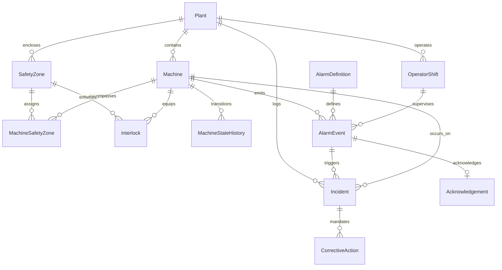

# Data Dictionary: Industrial Safety & Machine Intelligence Platform

## Overview
This document specifies the complete data dictionary for the Industrial Safety Intelligence Platform, covering all master entities, relationship bridge tables, transactional event records, incident workflows, and corrective action lifecycles.

Nomenclature conventions adhere strictly to:
- Safety Zones: `SAFE-<plant-id>-001`
- Alarm Events: `ALM-<machine-id>-000001`
- Incidents: `INC-2026-000001`
- Acknowledgements: `ACK-<alarm-id>-01`
- Corrective Actions: `ACT-<incident-id>-01`

---

## 1. Master Entity: Plant
Represents an industrial manufacturing facility containing production lines, safety zones, and machines.

| Field Name | Type | Required | Allowed Values / Format | Units | Uniqueness | Validation Rule & Business Constraint |
| :--- | :--- | :--- | :--- | :--- | :--- | :--- |
| `plant_id` | STRING | Required | Regex: `^PLT-[0-9]{2}$` (e.g., `PLT-01`) | None | Primary Key | Immutable plant code, zero-padded 2 digits. |
| `name` | STRING | Required | Non-empty text, max 100 chars | None | Unique | Distinct facility name (e.g., "Austin Gigafactory Line A"). |
| `code` | STRING | Required | Alpha-3 uppercase (e.g., `ATX`, `DET`, `STU`) | None | Unique | Official site routing code. |
| `location` | STRING | Required | Text, City + Country code | None | Non-unique | Must specify geographical jurisdiction. |
| `timezone` | STRING | Required | IANA Timezone (e.g., `America/Chicago`, `UTC`) | None | Non-unique | Valid timezone string for shift scheduling. |
| `operational_status` | STRING | Required | `ACTIVE`, `MAINTENANCE`, `DECOMMISSIONED` | None | Non-unique | Only `ACTIVE` plants can generate live telemetry. |
| `total_lines` | INTEGER | Required | Range: `1` to `50` | Lines | Non-unique | Must equal count of mapped production units. |
| `created_at` | DATETIME | Required | ISO 8601 UTC timestamp | None | Non-unique | Must be before all child entity creation dates. |

---

## 2. Master Entity: Machine
Represents physical manufacturing equipment operating within one or more safety zones.

| Field Name | Type | Required | Allowed Values / Format | Units | Uniqueness | Validation Rule & Business Constraint |
| :--- | :--- | :--- | :--- | :--- | :--- | :--- |
| `machine_id` | STRING | Required | Regex: `^MCH-[0-9]{3}$` (e.g., `MCH-001`) | None | Primary Key | Deterministic identifier, zero-padded 3 digits. |
| `plant_id` | STRING | Required | Foreign Key -> `Plant.plant_id` | None | Non-unique | Must reference an existing, active Plant. |
| `name` | STRING | Required | Non-empty text, max 100 chars | None | Non-unique | Descriptive unit title (e.g., "Stamping Press Alpha"). |
| `type` | STRING | Required | `CNC_MILL`, `ROBOTIC_ARM`, `HYDRAULIC_PRESS`, `CONVEYOR`, `STAMPING_UNIT`, `INJECTION_MOLDER` | None | Non-unique | Constrained industrial asset classification. |
| `criticality` | STRING | Required | `LOW`, `MEDIUM`, `HIGH`, `CRITICAL` | None | Non-unique | Governs alarm escalation priority. |
| `installation_date` | DATE | Required | ISO 8601 Date (`YYYY-MM-DD`) | None | Non-unique | Must precede operational timestamps. |
| `status` | STRING | Required | `RUNNING`, `IDLE`, `MAINTENANCE`, `TRIPPED`, `STOPPED` | None | Non-unique | Current state; matches latest state event. |
| `firmware_version` | STRING | Required | Semantic version `vX.Y.Z` | None | Non-unique | Must be validated against OT security catalog. |

---

## 3. Master Entity: SafetyZone
Physical or optical perimeter enclosing hazardous machinery with safety integrity levels (SIL).

| Field Name | Type | Required | Allowed Values / Format | Units | Uniqueness | Validation Rule & Business Constraint |
| :--- | :--- | :--- | :--- | :--- | :--- | :--- |
| `zone_id` | STRING | Required | Regex: `^SAFE-[A-Z0-9]+-[0-9]{3}$` (e.g., `SAFE-PLT01-001`) | None | Primary Key | Standard nomenclature incorporating parent plant ID. |
| `plant_id` | STRING | Required | Foreign Key -> `Plant.plant_id` | None | Non-unique | Must match prefix plant ID embedded in `zone_id`. |
| `name` | STRING | Required | Non-empty text, max 100 chars | None | Non-unique | Distinct zone tag (e.g., "Robotic Cell Perimeter 1"). |
| `hazard_classification` | STRING | Required | `MECHANICAL_PINCH`, `HIGH_VOLTAGE`, `THERMAL_RADIATION`, `CHEMICAL_EXPOSURE`, `ROBOTIC_COLLISION` | None | Non-unique | Mandatory ISO 12100 hazard classification. |
| `required_sil_level` | STRING | Required | `SIL_1`, `SIL_2`, `SIL_3`, `SIL_4` | IEC 61508 | Non-unique | Safety Integrity Level requirement. |
| `access_state` | STRING | Required | `RESTRICTED`, `CONTROLLED`, `OPEN`, `EMERGENCY_ISOLATED` | None | Non-unique | Dynamic containment status. |
| `max_occupancy` | INTEGER | Required | Range: `0` to `20` | Persons | Non-unique | Safety occupancy limit. 0 for robotic cells. |
| `created_at` | DATETIME | Required | ISO 8601 UTC timestamp | None | Non-unique | Master creation timestamp. |

---

## 4. Relationship Bridge: MachineSafetyZone
Many-to-Many bridge mapping machines to safety zones with effective date intervals.

| Field Name | Type | Required | Allowed Values / Format | Units | Uniqueness | Validation Rule & Business Constraint |
| :--- | :--- | :--- | :--- | :--- | :--- | :--- |
| `mapping_id` | STRING | Required | Regex: `^MSZ-[A-Z0-9]+-[0-9]{4}$` | None | Primary Key | Unique bridge record ID. |
| `machine_id` | STRING | Required | Foreign Key -> `Machine.machine_id` | None | Non-unique | Must reference valid Machine. |
| `zone_id` | STRING | Required | Foreign Key -> `SafetyZone.zone_id` | None | Non-unique | Must reference valid SafetyZone in same plant. |
| `primary_containment`| BOOLEAN| Required | `true`, `false` | None | Non-unique | Exactly one zone per machine should be primary. |
| `effective_from` | DATETIME | Required | ISO 8601 UTC timestamp | None | Non-unique | Start of machine zoning assignment. |
| `effective_to` | DATETIME | Optional | ISO 8601 UTC timestamp / NULL | None | Non-unique | NULL denotes current active assignment. |
| `active_status` | BOOLEAN | Required | `true`, `false` | None | Non-unique | Must be true if `effective_to` is NULL. |

---

## 5. Master Entity: Interlock
Safety mechanisms (physical guard door, light curtain, e-stop) that inhibit machine motion upon breach.

| Field Name | Type | Required | Allowed Values / Format | Units | Uniqueness | Validation Rule & Business Constraint |
| :--- | :--- | :--- | :--- | :--- | :--- | :--- |
| `interlock_id` | STRING | Required | Regex: `^ITL-[A-Z0-9]+-[0-9]{2}$` (e.g., `ITL-MCH001-01`) | None | Primary Key | Deterministic interlock identifier per machine. |
| `machine_id` | STRING | Required | Foreign Key -> `Machine.machine_id` | None | Non-unique | Parent machine protected by interlock. |
| `zone_id` | STRING | Required | Foreign Key -> `SafetyZone.zone_id` | None | Non-unique | Enclosing safety zone. |
| `name` | STRING | Required | Non-empty text, max 100 chars | None | Non-unique | Descriptive name (e.g., "Optical Curtain North"). |
| `interlock_type` | STRING | Required | `GUARD_DOOR`, `LIGHT_CURTAIN`, `EMERGENCY_STOP`, `PRESSURE_MAT`, `ENCLOSURE_LATCH` | None | Non-unique | Physical safety sensor category. |
| `safety_standard` | STRING | Required | `ISO_13849_1_CAT4`, `IEC_62061_SIL3`, `ANSI_B11_19` | Standard | Non-unique | Certified industrial compliance standard. |
| `state` | STRING | Required | `HEALTHY`, `TRIPPED`, `BYPASSED`, `FAULT` | None | Non-unique | Tripped/Fault must force machine STOP or TRIP. |
| `last_tested_date` | DATE | Required | ISO 8601 Date (`YYYY-MM-DD`) | None | Non-unique | Calibration proof within past 180 days. |
| `bypass_allowed` | BOOLEAN | Required | `true`, `false` | None | Non-unique | Strict administrative bypass policy flag. |

---

## 6. Master Entity: AlarmDefinition
Pre-engineered alarm limits and acknowledgement rules conforming to ISA-18.2 / IEC 62682.

| Field Name | Type | Required | Allowed Values / Format | Units | Uniqueness | Validation Rule & Business Constraint |
| :--- | :--- | :--- | :--- | :--- | :--- | :--- |
| `alarm_def_id` | STRING | Required | Regex: `^DEF-[0-9]{3}$` (e.g., `DEF-001` .. `DEF-200`) | None | Primary Key | Immutable catalogue identifier. |
| `code` | STRING | Required | Upper snake_case (e.g., `ALM_E_STOP_TRIP`) | None | Unique | Standard industrial telemetry tag. |
| `name` | STRING | Required | Non-empty text, max 100 chars | None | Non-unique | Clear human-readable operator description. |
| `category` | STRING | Required | `SAFETY`, `PROCESS`, `MECHANICAL`, `ELECTRICAL` | None | Non-unique | Alarm classification. |
| `default_severity` | STRING | Required | `CRITICAL`, `HIGH`, `MEDIUM`, `LOW` | None | Non-unique | Governs response priority and escalation SLA. |
| `sla_ack_seconds` | INTEGER | Required | Range: `30` to `7200` | Seconds | Non-unique | Max permissible latency before SLA breach. |
| `auto_resettable` | BOOLEAN | Required | `true`, `false` | None | Non-unique | If false, requires manual physical trip reset. |
| `requires_investigation` | BOOLEAN | Required | `true`, `false` | None | Non-unique | True for safety critical hazard alarms. |
| `description` | STRING | Required | Free text, max 255 chars | None | Non-unique | Standard operating procedure instructions. |

---

## 7. Master / Schedule Entity: OperatorShift
Shift scheduling record tracking active operator duty cycles and turnover logs across plants.

| Field Name | Type | Required | Allowed Values / Format | Units | Uniqueness | Validation Rule & Business Constraint |
| :--- | :--- | :--- | :--- | :--- | :--- | :--- |
| `shift_id` | STRING | Required | Regex: `^SHF-[0-9]{8}-[0-9]{2}$` (e.g., `SHF-20261001-01`) | None | Primary Key | Formatted with date and shift sequence. |
| `plant_id` | STRING | Required | Foreign Key -> `Plant.plant_id` | None | Non-unique | Plant site of shift operation. |
| `operator_id` | STRING | Required | Regex: `^OPR-[0-9]{4}$` | None | Non-unique | Certified operator badge identifier. |
| `operator_name` | STRING | Required | Full Name | None | Non-unique | Name of operating technician. |
| `shift_type` | STRING | Required | `MORNING`, `AFTERNOON`, `NIGHT` | None | Non-unique | 8-hour operational shift block. |
| `start_time` | DATETIME | Required | ISO 8601 UTC timestamp | None | Non-unique | Start of operator shift duty. |
| `end_time` | DATETIME | Required | ISO 8601 UTC timestamp | None | Non-unique | Must satisfy `end_time > start_time`. |
| `supervisor_name` | STRING | Required | Full Name | None | Non-unique | Designated plant safety officer. |
| `turnover_notes` | STRING | Optional | Text | None | Non-unique | Shift handover observations. |

---

## 8. Transaction / Event: MachineStateHistory
Immutable time-series ledger capturing machine operational state transitions.

| Field Name | Type | Required | Allowed Values / Format | Units | Uniqueness | Validation Rule & Business Constraint |
| :--- | :--- | :--- | :--- | :--- | :--- | :--- |
| `state_event_id` | STRING | Required | Regex: `^MST-[A-Z0-9]+-[0-9]{6}$` | None | Primary Key | Time-ordered event primary key. |
| `machine_id` | STRING | Required | Foreign Key -> `Machine.machine_id` | None | Non-unique | Machine undergoing state transition. |
| `shift_id` | STRING | Required | Foreign Key -> `OperatorShift.shift_id` | None | Non-unique | Active shift at transition time. |
| `previous_state` | STRING | Required | `RUNNING`, `IDLE`, `MAINTENANCE`, `TRIPPED`, `STOPPED` | None | Non-unique | Prior machine state. |
| `new_state` | STRING | Required | `RUNNING`, `IDLE`, `MAINTENANCE`, `TRIPPED`, `STOPPED` | None | Non-unique | New machine state; must differ from previous. |
| `timestamp` | DATETIME | Required | ISO 8601 UTC timestamp | None | Non-unique | Exact moment of transition. |
| `transition_reason`| STRING | Required | Text, max 200 chars | None | Non-unique | Root cause (e.g., `E_STOP_ACTIVATED`, `NORMAL_CYCLE`). |
| `interlock_trip_id`| STRING | Optional | Foreign Key -> `Interlock.interlock_id` | None | Non-unique | Linked interlock if transition was tripped. |

---

## 9. Transaction / Event: AlarmEvent
Dynamic alarm events emitted during industrial operations adhering to ISA-18.2 standards.

| Field Name | Type | Required | Allowed Values / Format | Units | Uniqueness | Validation Rule & Business Constraint |
| :--- | :--- | :--- | :--- | :--- | :--- | :--- |
| `alarm_event_id` | STRING | Required | Regex: `^ALM-[A-Z0-9]+-[0-9]{6}$` (e.g., `ALM-MCH001-000001`) | None | Primary Key | Mandatory zero-padded identifier per machine. |
| `machine_id` | STRING | Required | Foreign Key -> `Machine.machine_id` | None | Non-unique | Machine generating telemetry. |
| `alarm_def_id` | STRING | Required | Foreign Key -> `AlarmDefinition.alarm_def_id`| None | Non-unique | Reference definition catalog record. |
| `zone_id` | STRING | Required | Foreign Key -> `SafetyZone.zone_id` | None | Non-unique | Active safety zone containing machine. |
| `shift_id` | STRING | Required | Foreign Key -> `OperatorShift.shift_id` | None | Non-unique | Shift active during alarm trigger. |
| `timestamp` | DATETIME | Required | ISO 8601 UTC timestamp | None | Non-unique | Start timestamp of alarm activation. |
| `cleared_timestamp`| DATETIME| Optional | ISO 8601 UTC timestamp / NULL | None | Non-unique | When cleared, must be `>= timestamp`. |
| `duration_seconds` | FLOAT | Optional | Non-negative numeric | Seconds | Derived | Calculated: `cleared_timestamp - timestamp`. |
| `severity` | STRING | Required | `CRITICAL`, `HIGH`, `MEDIUM`, `LOW` | None | Non-unique | Inherited or escalated from definition. |
| `trigger_value` | FLOAT | Required | Real numeric | Eng. Units | Non-unique | Telemetry value breaching trip point. |
| `threshold_value` | FLOAT | Required | Real numeric | Eng. Units | Non-unique | Configured safe limit boundary. |
| `lifecycle_state` | STRING | Required | `ACTIVE`, `ACKNOWLEDGED`, `CLEARED`, `ESCALATED` | None | Non-unique | Lifecycle state transition stage. |
| `is_nuisance` | BOOLEAN | Required | `true`, `false` | None | Derived | Flagged if chattering or fleeting. |
| `nuisance_type` | STRING | Required | `NONE`, `CHATTERING`, `FLEETING` | None | Derived | ISA-18.2 nuisance classification. |
| `is_flood` | BOOLEAN | Required | `true`, `false` | None | Derived | True if part of >10 alarms / 10-min burst. |

---

## 10. Transaction / Action: Acknowledgement
Explicit operator interaction recording acknowledgement of active alarm alerts.

| Field Name | Type | Required | Allowed Values / Format | Units | Uniqueness | Validation Rule & Business Constraint |
| :--- | :--- | :--- | :--- | :--- | :--- | :--- |
| `ack_id` | STRING | Required | Regex: `^ACK-ALM-[A-Z0-9]+-[0-9]{6}-[0-9]{2}$` (e.g., `ACK-ALM-MCH001-000001-01`) | None | Primary Key | Explicit composite linkage to alarm event. |
| `alarm_event_id` | STRING | Required | Foreign Key -> `AlarmEvent.alarm_event_id` | None | Non-unique | Target alarm acknowledged by operator. |
| `shift_id` | STRING | Required | Foreign Key -> `OperatorShift.shift_id` | None | Non-unique | Duty shift when acknowledgement occurred. |
| `operator_id` | STRING | Required | Foreign Key -> `OperatorShift.operator_id` | None | Non-unique | Operator identity taking accountability. |
| `ack_timestamp` | DATETIME | Required | ISO 8601 UTC timestamp | None | Non-unique | Under normal rules: `ack_timestamp >= alarm.timestamp`. |
| `latency_seconds` | FLOAT | Required | Non-negative numeric | Seconds | Derived | Calculated: `ack_timestamp - alarm.timestamp`. |
| `sla_breached` | BOOLEAN | Required | `true`, `false` | None | Derived | Calculated: `latency_seconds > def.sla_ack_seconds`. |
| `ack_method` | STRING | Required | `HMI_TOUCH`, `PHYSICAL_CONSOLE`, `SCADA_DESK` | None | Non-unique | Interface mechanism used to acknowledge. |
| `comment` | STRING | Optional | Text, max 255 chars | None | Non-unique | Operator rationale or action note. |

---

## 11. Transaction / Governance: Incident
Safety incident records created for hazardous breaches, near-misses, and emergency stops.

| Field Name | Type | Required | Allowed Values / Format | Units | Uniqueness | Validation Rule & Business Constraint |
| :--- | :--- | :--- | :--- | :--- | :--- | :--- |
| `incident_id` | STRING | Required | Regex: `^INC-[0-9]{4}-[0-9]{6}$` (e.g., `INC-2026-000001`) | None | Primary Key | Standard enterprise safety incident sequence. |
| `plant_id` | STRING | Required | Foreign Key -> `Plant.plant_id` | None | Non-unique | Facility where incident transpired. |
| `machine_id` | STRING | Required | Foreign Key -> `Machine.machine_id` | None | Non-unique | Affected equipment. |
| `zone_id` | STRING | Required | Foreign Key -> `SafetyZone.zone_id` | None | Non-unique | Impacted safety zone perimeter. |
| `triggering_alarm_id`| STRING | Optional | Foreign Key -> `AlarmEvent.alarm_event_id` | None | Non-unique | Root trigger alarm. Nullable for edge cases. |
| `shift_id` | STRING | Required | Foreign Key -> `OperatorShift.shift_id` | None | Non-unique | Shift during incident event. |
| `timestamp` | DATETIME | Required | ISO 8601 UTC timestamp | None | Non-unique | Time of incident inception. |
| `severity` | STRING | Required | `CRITICAL`, `MAJOR`, `MINOR`, `NEAR_MISS` | None | Non-unique | Severity rating per OSHA / ISO 45001. |
| `incident_type` | STRING | Required | `INTERLOCK_BYPASS_VIOLATION`, `ZONE_INTRUSION_DURING_CYCLE`, `EMERGENCY_STOP_FAILURE`, `THERMAL_RUNAWAY_BREACH`, `UNCONTROLLED_MOTION` | None | Non-unique | Root hazard category. |
| `description` | STRING | Required | Text, max 500 chars | None | Non-unique | Detailed narrative of hazardous event. |
| `osha_reportable` | BOOLEAN | Required | `true`, `false` | None | Non-unique | True if statutory reporting is mandated. |
| `lost_work_hours` | FLOAT | Required | Non-negative numeric | Hours | Non-unique | Downtime and personnel lost hours. |
| `machine_state_at_incident`| STRING | Required | `RUNNING`, `IDLE`, `MAINTENANCE`, `TRIPPED`, `STOPPED` | None | Non-unique | Historical machine state at time of incident. |
| `lifecycle_status` | STRING | Required | `REPORTED`, `UNDER_INVESTIGATION`, `ACTION_PENDING`, `RESOLVED`, `CLOSED` | None | Non-unique | Governance workflow state. |

---

## 12. Transaction / Governance: CorrectiveAction
Remedial engineering actions initiated to eliminate root cause and prevent recurrence.

| Field Name | Type | Required | Allowed Values / Format | Units | Uniqueness | Validation Rule & Business Constraint |
| :--- | :--- | :--- | :--- | :--- | :--- | :--- |
| `action_id` | STRING | Required | Regex: `^ACT-INC-[0-9]{4}-[0-9]{6}-[0-9]{2}$` (e.g., `ACT-INC-2026-000001-01`) | None | Primary Key | Linked action identifier referencing incident ID. |
| `incident_id` | STRING | Required | Foreign Key -> `Incident.incident_id` | None | Non-unique | Parent incident requiring remediation. |
| `action_type` | STRING | Required | `HARDWARE_REPLACEMENT`, `SOFTWARE_INTERLOCK_UPDATE`, `OPERATOR_RETRAINING`, `SENSOR_CALIBRATION`, `SAFETY_GUARD_REDESIGN` | None | Non-unique | Corrective action category. |
| `description` | STRING | Required | Text, max 500 chars | None | Non-unique | Prescribed engineering resolution. |
| `assigned_to` | STRING | Required | Text, Engineer Name / ID | None | Non-unique | Lead maintenance or quality engineer. |
| `due_date` | DATE | Required | ISO 8601 Date (`YYYY-MM-DD`) | None | Non-unique | Committed completion deadline. |
| `completed_date` | DATE | Optional | ISO 8601 Date / NULL | None | Non-unique | Must be `>= incident.timestamp`. |
| `verified_by` | STRING | Optional | Text, QA Lead Name / NULL | None | Non-unique | Independent sign-off auditor. |
| `verification_date`| DATE | Optional | ISO 8601 Date / NULL | None | Non-unique | Mandatory for `status='CLOSED'` under compliance rules. |
| `status` | STRING | Required | `PENDING`, `IN_PROGRESS`, `COMPLETED`, `VERIFIED`, `CLOSED` | None | Non-unique | Lifecycle state. |
| `effectiveness_score`| FLOAT | Optional | Range: `0.0` to `1.0` / NULL | Ratio | Derived | Recurrence prevention metric. |
| `recurrence_prevention_notes`| STRING| Optional | Text | None | Non-unique | Engineering design changes implemented. |

---

## Cardinality & Relationship Matrix

| Relationship | Cardinality | Join Validation Rule | Optionality |
| :--- | :--- | :--- | :--- |
| `Plant` -> `Machine` | 1 : N | `Machine.plant_id = Plant.plant_id` | Mandatory |
| `Plant` -> `SafetyZone` | 1 : N | `SafetyZone.plant_id = Plant.plant_id` | Mandatory |
| `Machine` <-> `SafetyZone` | M : N | Via `MachineSafetyZone` bridge table | Mandatory |
| `Machine` -> `Interlock` | 1 : N | `Interlock.machine_id = Machine.machine_id` | Mandatory |
| `Machine` -> `MachineStateHistory` | 1 : N | `MachineStateHistory.machine_id = Machine.machine_id` | Mandatory |
| `AlarmDefinition` -> `AlarmEvent`| 1 : N | `AlarmEvent.alarm_def_id = AlarmDefinition.alarm_def_id`| Mandatory |
| `Machine` -> `AlarmEvent` | 1 : N | `AlarmEvent.machine_id = Machine.machine_id` | Mandatory |
| `AlarmEvent` -> `Acknowledgement`| 1 : 1..N | `Acknowledgement.alarm_event_id = AlarmEvent.alarm_event_id` | Optional (only ack'd alarms) |
| `AlarmEvent` -> `Incident` | 1 : 0..1 | `Incident.triggering_alarm_id = AlarmEvent.alarm_event_id` | Optional (only safety trips) |
| `Incident` -> `CorrectiveAction` | 1 : 1..N | `CorrectiveAction.incident_id = Incident.incident_id` | Mandatory |
